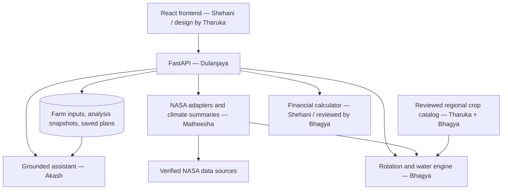

# Architecture — proposed v0.1

Status: design agreement for the first build; none of these services is implemented yet.

## Core flow

1. Save a farm and increment its input version on changes.
2. Retrieve observations, preserving source dates, resolution, units, and missing values.
3. Analyze an explicit farm snapshot against an approved crop catalog and model version.
4. Run a hypothetical scenario from an immutable baseline analysis. A scenario changes specified inputs, not historical observations.
5. Save a selected candidate with its analysis and source references.
6. Resolve assistant context on the server using the selected IDs. Explain only the available structured results.

## Boundaries

- API prefix: `/api/v1`. Domain functions do not depend on frontend state.
- Provider credentials stay server-side. Farm updates use input versions to prevent overwriting newer edits.
- Historical observations, synthetic fixtures, modeled estimates, and hypothetical scenarios remain distinguishable in storage and UI.
- Cache provider responses with retrieval time and coverage. A provider failure produces a clear unavailable response or dated cache result.
- Financial ranges depend on sourced user/local inputs. Climate similarity does not establish agronomic equivalence.
- Weed, voice, notifications, offline writes, and climate twins are follow-on integrations. Final service/library choices need verification during implementation.

## Decisions still needed

Record decisions and reasons here as they are made: database/deployment target; runtime versions; first NASA product and access method; map tiles and license; crop region/season definitions; reviewed scoring rules; AI provider/model; authentication before accepting real farmer data; offline conflict policy; team-approved license.
