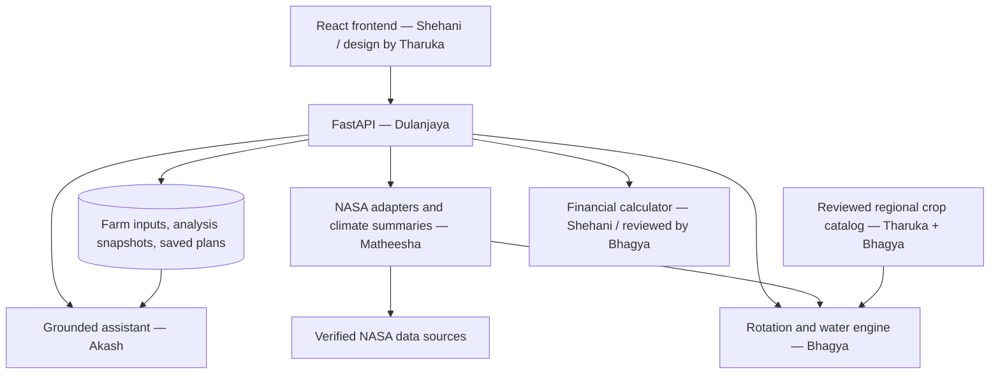

# Architecture — proposed v0.1

Status: FastAPI, SQLAlchemy/SQLite farm persistence, validation, version checks, and environment-based database/CORS configuration are implemented. The farm observations route integrates Matheesha's standalone NASA POWER fetch/normalization module. Other analytical services and the frontend below remain proposed. See [backend setup](../backend/README.md).

## Core flow

1. Save a farm and increment its input version on changes.
2. Retrieve observations, preserving source dates, resolution, units, and missing values.
3. Analyze an explicit farm snapshot against an approved crop catalog and model version.
4. Run a hypothetical scenario from an immutable baseline analysis. A scenario changes specified inputs, not historical observations.
5. Save a selected candidate with its analysis and source references.
6. Resolve assistant context on the server using the selected IDs. Explain only the available structured results.

## Boundaries

- API prefix: `/api/v1`. Domain functions do not depend on frontend state.
- Provider credentials stay server-side. Farm updates use input versions to prevent overwriting newer edits.
- Historical observations, synthetic fixtures, modeled estimates, and hypothetical scenarios remain distinguishable in storage and UI.
- Cache provider responses with retrieval time and coverage. A provider failure produces a clear unavailable response or dated cache result.
- Financial ranges depend on sourced user/local inputs. Climate similarity does not establish agronomic equivalence.
- Weed, voice, notifications, offline writes, and climate twins are follow-on integrations. Final service/library choices need verification during implementation.

## Decisions still needed

Record decisions and reasons here as they are made: production database/deployment target (SQLite is the current local default); production runtime versions; production observation retention and background refresh policy (POWER snapshots currently use a configurable 24-hour fresh-cache lifetime); map tiles and license; crop region/season definitions; reviewed scoring rules; AI provider/model; authentication before accepting real farmer data; offline conflict policy; team-approved license.

## Implemented observation boundary

`GET /api/v1/farms/{farm_id}/observations` reads farm coordinates and input version from
SQLite, validates historical dates, and calls the dependency-injected `ObservationAdapter`.
The default adapter reuses Matheesha's unchanged `backend/services/nasa_power.py` from
commit `c580b4fc620212f5450e388ed951e7cef5c014f6`. Only that standalone module is imported;
his separate SMAP, climate indicator, and scenario services are not exposed here.
The HTTP layer preserves normalized results and adds farm/observation IDs, version,
units, coverage disclosure and contract aliases. Missing or unusable services produce 503.
POWER results remain modeled estimates, with missing values preserved.

`observation_snapshots` stores immutable response JSON, the complete original farm profile,
its input version, cache-key generations and separate cache creation/expiry timestamps.
Startup adds this table without modifying the existing farm table. The cache key covers farm,
version, coordinates, period and versioned provider settings. Fresh requests reuse stable IDs;
expiry or version changes append snapshots. Unique key/generation constraints resolve concurrent
writers to one committed ID. Network calls run outside the database read transaction.
Old snapshots remain readable at `/api/v1/observations/{observation_id}`. Failed refreshes return
503 rather than silently using expired or synthetic values. Cache expiry and farm-version
staleness are separate: the future-analysis reference helper permits historical IDs for matching
current inputs but rejects ownership/version conflicts. Future analysis saves must recheck
input versions when committing. No crop calculations are added. See [backend details](../backend/README.md#climate-observations).
# Implemented rotation boundary

The farm rotation POST now validates the current farm and immutable observation,
adapts explicit season labels and exclusions to Bhagya's unchanged vendored engine,
and appends `rotation_analyses` with original input/catalog snapshots. Saving
atomically rechecks the farm version. Water calculations await matching seasonal
climate periods and approved crops; no missing inputs are synthesized. See
[integration details](../backend/ROTATIONS.md) and
[engine provenance](../backend/agrosphere_rotation/VENDORED.md).

## Implemented climate scenario boundary

The scenario POST validates the saved baseline and original observation context,
replays supported rotation calculations against saved inputs, and appends a
`climate_scenarios` row containing parameters, provenance snapshots and results.
It preserves the baseline and observation without requiring the farm to remain
at the old version. Unavailable seasonal climate and unapproved demand prevent
numerical water changes; these limitations remain explicit. See
[scenario behavior and persistence](../backend/SCENARIOS.md).
