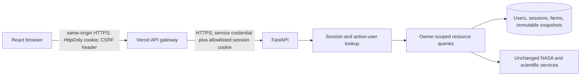

# Authentication and farm ownership design

Status: proposal for team approval, not an implemented security feature.
Prepared on 2026-11-15 for `dulanjaya/authentication`.
Only this document is added. No runtime, database, dependency, deployment or
scientific-data changes are authorized by this design task.

## 1. Repository findings and scope

Inspected this branch at `db6a68d`: FastAPI routes, schemas, SQLAlchemy models,
`snapshot_context`, observation caching, saved-plan persistence, API contracts,
architecture, React routing/client, Zustand state, draft/offline storage, and tests.
The working tree was clean before this document. There are 21 current HTTP
method/path operations in the route files; the ownership matrix below covers all.

This branch has no user/session tables, login UI, current-user dependency or
ownership column. `Farm` has only `id`, `input_version` and `profile`. Saved
observations contain complete historical farm profiles; public NASA source data
does not make those farm-linked records public. Existing context validation checks
ID relationships and versions, not who may access them. Startup uses
`Base.metadata.create_all`, not versioned migrations.

The deployment work is not present on this branch. It was inspected read-only
from `dulanjaya/render-vercel` at `48f9516` and the separate
`dulanjaya/staging-deployment` branch. Render/Vercel preparation uses a server-only
shared backend Bearer token, a Basic-auth Vercel proxy and optional platform
protection. That shared gate is not individual identity or farm authorization.
Its proxy deliberately removes cookies and Set-Cookie; it cannot carry the proposed
user session unchanged. Do not assume either deployment PR is already merged.

Scientific boundaries remain unchanged: Matheesha's NASA adapters, Bhagya's shared
rotation/water algorithms, Akash's explanation/normalization logic, crop review
statuses, historical snapshot JSON and data-kind/limitations disclosures.
Authentication belongs in HTTP/context/persistence boundaries around them.

## 2. Recommended approach and alternatives

**Recommend first-party, database-backed opaque sessions for the initial invited
staging users, with Argon2id password hashing and a same-origin Vercel gateway.**
FastAPI is the authority for users, sessions and ownership. React keeps no access
token in localStorage. PostgreSQL must be validated and durably provisioned before
hosting persistent accounts; ephemeral SQLite is suitable only for disposable
local/test accounts. If the team cannot operate recovery, abuse controls and
security updates, choose managed OIDC instead before implementing password storage.

| Option | Benefits | Costs / decision |
| --- | --- | --- |
| First-party opaque session cookie | Immediate server revocation; simple same-origin browser requests; minimal token exposure | Requires CSRF, password/recovery lifecycle, durable session storage and abuse controls. Recommended for invited staging, subject to ownership of these responsibilities. |
| Managed OIDC using authorization code + PKCE, preferably through a gateway session | Provider operates passwords, verification and potentially MFA | Provider availability, pricing, email/privacy policy and callback setup need approval. Keep internal user UUIDs and link verified issuer+subject, never auto-link accounts by matching email alone. |
| FastAPI-issued access/refresh JWTs | Useful for future non-browser clients | Refresh rotation/reuse detection, key rotation and revocation add complexity; cookies still need CSRF. Not recommended for this browser-only first release. |

FastAPI supports multiple security libraries; its JWT tutorial is an option, not a
requirement to issue JWTs. Do not use OAuth password grants for an external provider,
invent an OAuth server, or build a custom password hash algorithm.

Authentication and authorization are separate: a valid session identifies a user;
owner-scoped queries decide which records that user may access. A service token,
Vercel account, guessed UUID, fixture ID, email address or client `user_id` is never
sufficient to authorize farm data.

## 3. Registration, passwords and account lifecycle

### Registration policy

Default to **invitation-only staging registration**, disabled unless configured.
Proposed request: email, password and an opaque single-use invitation token. The
server binds invitations to a normalized email, hashes their random tokens, checks
expiry and atomically consumes them with account creation. No role, owner, verified
status or account status is accepted from client input. Public self-registration
needs a separate approval, verified email delivery and effective abuse controls.

Normalize validated email consistently for case-insensitive lookup, preserve the
validated display form, and enforce a database unique key on the lookup value.
Specify/test Unicode and international-domain handling before implementation;
do not apply provider-specific dot/plus-address rewriting. Duplicate concurrent
registrations must be resolved by the unique constraint, not just a prior SELECT.

Account creation does not silently prove email ownership. Default to pending
verification/approval, with a short-lived verification flow before activation.
For an email-provider-free staging pilot, an operator may approve known invited
reviewers through an audited out-of-band process; that exception needs team
approval and must not be labeled automatic mailbox verification. Never activate
accounts from arbitrary email claims or manufacture verified timestamps.

### Password handling

Use reviewed `pwdlib` with Argon2id support (and its maintained underlying library).
Pin compatible versions after implementation-time advisory checks; no dependency
is installed by this design. Library-generated salts and encoded parameters stay
inside the password hash; never store plaintext/reversible passwords or use SHA256
alone for passwords. SHA256 is appropriate only for high-entropy session/invite
tokens described below.

Proposed password policy: minimum 15 characters while MFA is absent, maximum 128
Unicode code points plus a documented request byte limit; permit spaces, paste and
password managers. Reject oversize values explicitly, never trim, normalize or
silently truncate passwords. Screen common/compromised passwords using a reviewed
privacy-preserving/local mechanism. Do not require arbitrary character composition
or routine forced changes without evidence of compromise.

Benchmark Argon2id on the actual Render instance. A proposed starting point is
64 MiB, three iterations, parallelism one, subject to a measured latency/memory
budget and current OWASP guidance. Bound simultaneous hashing operations so login
abuse cannot exhaust a small instance. Verify unknown users against a dummy hash;
use the same generic login failure for unknown, incorrect, disabled and unapproved
accounts. Rehash outdated parameters after successful verification, transactionally.

Throttle registration, login and recovery by account lookup hash and source/network,
with shared durable state or a reviewed managed limiter. An in-memory per-process
counter is insufficient across Vercel instances/Render restarts. Avoid permanent
account locks that attackers can trigger. Return 429 with Retry-After when limited;
do not expose internal rate keys. Trust forwarded IP metadata only from the reviewed
gateway/proxy chain; never trust arbitrary client X-Forwarded-For.

### Recovery and sensitive changes

Specify verification and password-reset tokens as independent, random, hashed,
short-lived and single-use; generic recovery-request responses avoid enumeration.
Build delivery only after selecting a mail provider and preventing token/URL logs.
Password reset/change revokes all sessions; password change requires the current
password or recent verified reauthentication. Email change requires reauthentication
and verification of the new address, not a direct editable `/me` field. Disabled
users cannot log in, and existing sessions stop working immediately. No account
deletion or ownership transfer endpoint in the first release; use a separately
approved retention/export policy. No security questions or default/shared passwords.

MFA/passkeys and managed OIDC are follow-on decisions; do not claim they exist.
Do not accept real farmer data until verified recovery, secure operations and
ownership tests are complete, not merely until a login page appears.

## 4. Session and CSRF design

Generate at least 32 random bytes for each opaque session token using a CSPRNG.
Store only its SHA256 digest with a unique index; raw tokens appear only in the
HttpOnly cookie and transient server processing. Load the session, active user,
revocation and expiry from the database on every request. Database failure returns
503 without treating the caller as anonymous or falling back to demo data.

Cookie proposal: `__Host-agrosphere_session`, `Secure`, `HttpOnly`, `SameSite=Lax`,
`Path=/`, no Domain; expiry cannot exceed the server absolute expiry. Proposed
authenticated limits: 30-minute idle and 12-hour absolute lifetime, no extended
remember-me. Update idle activity atomically and at a bounded frequency; never
extend beyond the absolute limit. Limit concurrent sessions (proposal: five) and
revoke oldest on exceeding the limit. These numbers require team approval.

Rotate to a fresh token on login and privilege change; revoke the previous record.
Do not upgrade a browser-supplied pre-login token into an authenticated session.
Logout revokes the current session and expires the cookie with identical scope;
logout-all, reset, account disable and suspected compromise revoke all sessions.
Cookies alone do not provide logout: the server record must be revoked. An
in-flight write must recheck account/session validity at its commit boundary.

### Browser CSRF protocol

1. `GET /auth/csrf` establishes a short-lived pre-auth session if needed and returns
   a CSRF token with `Cache-Control: no-store`. It exposes no user records. Bound
   anonymous creation/cleanup to avoid filling the sessions table.
2. Derive a session-bound token with HMAC-SHA256 over a domain-separated session
   digest using a dedicated server-side CSRF secret. Return it only in same-origin
   JSON; keep it in React memory. This permits reload/multiple tabs without storing
   a recoverable raw session token in the DB or rotating CSRF on every read.
3. Login and registration require the pre-auth cookie, CSRF header and exact trusted
   browser Origin. A successful login revokes pre-auth state, creates a fresh auth
   cookie, and the frontend obtains the new session's CSRF token.
4. All unsafe application methods, including assistant/scenario computations,
   feedback, logout and password actions, require the header and Origin. Validate
   CSRF in constant time at FastAPI as well as the gateway's Origin check. Reject
   cross-site Fetch Metadata where available and simple form content types for
   JSON APIs. SameSite is defense in depth, not the entire CSRF control.
5. An expired session cannot be refreshed merely by possessing an old CSRF value.
   Protected writes return 401; clear client state and bootstrap a new pre-auth
   session for login. Logout without a valid session must remain safe/idempotent
   with an exact-origin policy; never let a cross-origin request clear cookies.

Keep CSRF key versions/rotation explicit: rotate the key, fetch a fresh token and
retry only a definitely rejected CSRF request once. Never automatically replay a
write after an ambiguous timeout. Login CSRF, fixation, cross-tab changes and
multiple Set-Cookie handling are acceptance tests, not optional polish.

Local development should use the same-origin Vite API proxy or local HTTPS. If
plain-HTTP localhost requires a separate cookie name without `__Host-`/Secure,
make that an explicit local-only configuration with startup checks; hosted mode
must reject it. No permissive production cookie fallback to make tests pass.

## 5. Proposed auth API contract

All paths below are **proposed**, under `/api/v1`; they are not added to current
contracts as implemented endpoints. Auth JSON uses the existing error envelope.
No endpoint returns password/session/invitation digests or the raw session token.

| Operation | Input | Result / boundary |
| --- | --- | --- |
| GET `/auth/csrf` | Existing cookie, if any | 200 `{csrf_token}`; pre-auth cookie if absent; no-store |
| POST `/auth/register` | Email, password, invitation; pre-auth CSRF | 201 minimal user/status; pending unless verified/approved; no automatic authenticated session |
| POST `/auth/login` | Email, password; pre-auth CSRF | 200 minimal user; new session Set-Cookie; generic 401 for invalid credentials/account state |
| GET `/auth/me` | Auth session cookie | 200 `{id,email,status}`; 401 otherwise; no-store |
| POST `/auth/logout` | Session/CSRF | 204 and cookie expiration; safe for repeated logout, exact-origin policy always |
| POST `/auth/logout-all` | Auth session/CSRF, recent reauthentication | 204, revoke every user session |
| POST `/auth/password` | Current/new password, auth/CSRF | 204; revoke sessions and require login again |
| POST `/auth/password-reset/request` | Email, pre-auth CSRF | Generic 202; enabled only after reviewed recovery delivery |
| POST `/auth/password-reset/confirm` | Reset token/new password, pre-auth CSRF | 204 on valid single-use token; sessions revoked |
| POST `/auth/email/verify` | Verification token, pre-auth CSRF | Activation only after verification/approval policy is satisfied |

Use 401 `UNAUTHENTICATED` for missing/invalid/expired application sessions,
403 `CSRF_INVALID` for CSRF failure, 404 `NOT_FOUND` for missing **or unowned**
resources, 409 for owned-context/version conflicts, 422 for safe field validation,
429 `RATE_LIMITED`, and 503 for auth/storage unavailability. Generic invalid
registration/invitation errors must not reveal whether an arbitrary email exists.
Do not include password values in validation details, logs or monitoring events.

The existing hosted service-token layer's 401 `UNAUTHORIZED` is a separate gateway
failure and should not cause a user login loop. Distinguish that operational error
from a user session expiry at the proxy/UI boundary without exposing secrets.

An own-farm index (`GET /farms`, paginated minimal envelopes) is a proposed additive
follow-up for account discovery on new devices; it does not currently exist.
Keep existing farm envelopes/profile schemas unchanged and existing plan list
filters compatible. Never offer a global directory of farms or emails.

## 6. Ownership policy and endpoint matrix

**One user owns each farm; no sharing, transfer or implicit administrator access
in the initial scope.** Set ownership from the authenticated server principal on
farm creation. Reject client `owner_id`/`user_id` fields. Internal user identity
must not be added to the scientific farm profile or immutable result JSON.

Use `Farm.owner_id` as the canonical access relationship. Child records inherit
access through their relational farm/plan references, avoiding duplicated owner
columns that can drift. Retain all current relationship, input-version and payload
integrity checks after ownership is established. Candidate IDs are scoped to a
particular owned baseline or scenario, never independently trusted identifiers.

| Current method/path (all `/api/v1`) | Required authorization |
| --- | --- |
| GET `/health` | Minimal public liveness only; no record/schema/user detail |
| POST `/farms` | Active authenticated user + CSRF; server assigns owner |
| GET `/farms/{farm_id}` | Owner-scoped farm query |
| PATCH `/farms/{farm_id}` | Owner + CSRF + existing expected version; include owner predicate in atomic UPDATE |
| GET `/farms/{farm_id}/observations` | Own farm before cache access, coordinates or NASA calls; own snapshot cache only |
| GET `/observations/{observation_id}` | Snapshot joined to its owned farm before serializing stored profile/sources |
| POST `/observations/{observation_id}/rainfall-scenarios` | Own observation/farm + CSRF, then existing hypothetical transformation |
| POST `/farms/{farm_id}/rotations` | Own farm and referenced observation + CSRF, matching farm/version; repeat authorization at persistence boundary |
| POST `/analyses/{analysis_id}/scenarios` | Own baseline farm, original observation and consistent analysis graph + CSRF |
| GET `/scenarios/{scenario_id}` | Scenario joined to owned farm and baseline; preserve historical reads |
| POST `/assistant/messages` | Own farm, analysis, observation and any selected scenario/candidate + CSRF before normalization/provider access |
| POST `/farms/{farm_id}/plans` | Own farm and complete selected graph + CSRF + version guard |
| POST `/plans` | Same checks for body `farm_id`; no alternate authorization bypass |
| GET `/plans?farm_id=...` | Own farm; owner-filter SQL before pagination/counting, including all rows returned |
| GET `/plans/{plan_id}` | Plan's relational farm owner first; then existing embedded historical validation |
| POST `/plans/{plan_id}/feedback` | Own plan/farm + CSRF; server records actor, preserves farmer-input label |
| GET `/plans/{plan_id}/feedback` | Own plan before listing feedback |
| GET `/farms/{farm_id}/soil-moisture` | Own farm before resolving verified local SMAP context |
| GET `/farms/{farm_id}/gpm-precipitation` | Own farm before resolving verified local GPM context |
| GET `/farms/{farm_id}/hls-vegetation` | Own farm before resolving verified local HLS context |
| GET `/farms/{farm_id}/climate-twins?observation_id=...` | Own target farm/observation; comparison inputs restricted to the same user's farms |

### Subtle access rules

- Authenticate before database-bound business validation/provider work. Establish
  ownership of each supplied ID before reporting cross-context/version details:
  Alice's farm + Bob's analysis -> indistinguishable 404, not a revealing 409.
  Alice's two owned but mismatched contexts can retain existing 409 behavior.
- Never authorize from JSON snapshots, localStorage, a forwarded `X-User-ID`, email
  or an owner field supplied by a caller. Join canonical relational columns and
  fail closed if payload/row IDs disagree; do not serialize corrupt foreign data.
- Old analyses/scenarios/plans stay readable by their owner after profile edits.
  Ownership is not `input_version`; preserve existing staleness rules for new
  computations/saves and historical source payloads for reads.
- Farm ownership is not editable in PATCH. Disable user/farm deletion or enforce
  RESTRICT until retention/export behavior is approved, so history cannot become
  an orphaned publicly readable record. Ownership transfer is a separate design.
- Every new API route defaults to authenticated access, with explicit public auth
  bootstrap/health exceptions. Route inventory tests must catch omissions. Keep
  service-layer owner context required too, so alternate route/resolver paths do
  not bypass dependencies.
- Include owner and expected version in conditional updates used by farm editing,
  rotation insertion and plan saving; recheck session/account validity before
  commit after long provider/analysis work. Do not hold a database transaction open
  during a NASA network call. Define logout as blocking subsequent commits; an
  already committed result remains owner-only. Test ordering/races explicitly.

For implementation, define a common commit-time authorization fence: after any
existing `db.rollback()` that ends the calculation/read transaction, start the
write transaction and lock/revalidate the user, session, then farm in a consistent
order. Logout/disable/revoke operations must take compatible user/session locks.
PostgreSQL row-lock ordering and SQLite's write transaction need separate tested
implementations. Hold that fence through insertion/commit, not during external
work. A dependency check made before calculation, or a SELECT whose transaction
is later rolled back, cannot guarantee revocation before commit. Do not add a new
lock then immediately discard it through the existing persistence helpers.

### Climate-twin privacy

The current route scans observations from **all registered farms**, returns matches
and exclusions, and therefore needs more than a target-farm guard. Select eligible
farm IDs by current user in SQL *before* latest-snapshot selection/ranking. Remove
other users' IDs, locations, counts and exclusion reasons from the candidate set.
Call the unchanged `rank_snapshot_twins` algorithm with this permitted subset;
disclose that the comparison scope is the user's own farms, and honestly return
empty results when none are eligible. Do not invent comparison farms. Cross-user
sharing would require consent, disclosure minimization and a separate contract.

Observation cache keys already include farm/version; retain that separation.
Do not deduplicate farm-linked snapshots across users because they contain profiles
and IDs. A future neutral NASA provider cache would be a different privacy design.

## 7. Schema and migrations

Proposed relational changes, not scientific payload changes:

| Table/change | Proposed fields and constraints |
| --- | --- |
| `users` (new) | Internal UUID PK; validated email/display form; unique normalized email key; encoded password hash; status; email verification time; created/updated/auth-change times |
| `auth_sessions` (new) | UUID/internal ID; unique token digest; nullable user FK; kind `preauth`/`authenticated`; created/last-seen/idle/absolute/revoked timestamps; index user+expiry |
| `auth_invitations` (new) | Unique random token digest; normalized invited email; expiry/consumed time; operator/issuer reference; no plaintext token |
| `auth_action_tokens` (new, recovery stage) | Token digest, purpose, user FK, expiry/consumed time; distinct token purposes; single-use constraints/transaction checks |
| `farms.owner_id` (new) | Nullable during legacy quarantine; FK to users with RESTRICT, indexed; server-required for every new authenticated farm |
| `season_feedback.created_by_user_id` (new) | Nullable for historical feedback, server-set for new feedback; audit actor, not an independent grant of access |
| `security_events` (new) | Minimal event ID/type/time, actor/target identifiers when safe, outcome; no passwords, raw cookies/tokens, farm payloads or questions; retention policy required |

Use explicit UTC epoch timestamps consistently with existing SQLite snapshot
conventions, or a tested UTC-aware type policy approved before migration. Enforce
that authenticated sessions have a user and pre-auth sessions do not; user/session
status/revocation constraints must be checked regardless of a valid cookie digest.
Keep session/invitation/recovery cleanup bounded; expired rows are not valid while
awaiting cleanup. No plaintext CSRF/session secret column is needed for the HMAC
design. Encryption and access controls for backups remain mandatory.

Add Alembic configuration/versioned revisions before changing schemas. Procedure:

1. Back up the existing DB consistently, record schema/version, table counts and
   snapshot hashes; rehearse on copies. Resolve the separate PostgreSQL validation
   gate and supported storage target first. Never silently rewrite DATABASE_URL.
2. Establish a reviewed baseline for the exact existing six tables. Inspect actual
   tables/columns/indexes/constraints before stamping an existing database; do not
   blindly stamp unknown schemas or reset data. Fresh databases must upgrade from
   baseline through all revisions.
3. Add auth tables and nullable ownership/actor fields with appropriate indexes.
   SQLite requires reviewed batch-table operations for some foreign key changes;
   PostgreSQL requires tests for real constraints, unique-email races and row locks.
   Validate SQLite FK enforcement and pre-existing orphan rows explicitly before
   enabling constraints; do not quietly delete invalid history.
4. Quarantine existing ownerless records. Backfill ownership only through the
   operator procedure below, not a migration guessing from profile names/emails.
5. Deploy server-side ownership enforcement before opening registrations/data
   access; then release the authenticated UI. In hosted mode, fail startup if the
   required migration revision is absent. Use a migration job/manual approved
   upgrade, not competing auto-migrations from multiple web workers. Remove
   `create_all` as a hosted migration mechanism; retain controlled test setup.
6. Verify all old IDs, versions, source references, nulls, candidate results and
   historical JSON payloads are unchanged. Run migration and account-isolation tests
   against both supported DB engines and restore/restart checks.

Do not drop auth/owner columns as a routine rollback: a prior anonymous application
would expose the database. Roll back under maintenance/restricted access using a
compatible image or restored pre-upgrade backup, never reopen an anonymous build
against owned records. Downgrades that lose security metadata require explicit
operator approval and preserved backups.

## 8. Existing anonymous demonstration data

Treat every pre-authentication farm as **unassigned/quarantined**, including its
observation, analysis, scenario, saved-plan and feedback descendants. Nullable
owner IDs mean *no ordinary user access*, not shared/public access. Preserve rows
and immutable payloads; do not grant them to the first registered user or anyone
presenting a previously public UUID or locally cached plan.

An operator reviews source/data sensitivity and may explicitly assign a known
synthetic demo farm to a dedicated demo account or a verified responsible owner.
Record actor, farm, previous/new ownership and reason in an audited transaction;
verify the entire relational graph. This is not a self-service claim endpoint.
If provenance/ownership is uncertain, leave quarantined. Do not relabel real inputs
as synthetic to make assignment easier. No bulk deletion/reset is part of auth.

Static frontend fixture mode remains an explicitly labeled demonstration with
separate storage and no backend identity claim. A fake fixture login is not proof
of security and must not silently activate when a session/API fails. Keep existing
anonymous API behavior only in explicitly controlled legacy test fixtures while
migrating tests; never keep a hosted anonymous-access feature switch for records.

## 9. Frontend integration and browser data isolation

Add login/registration/logout UI through the existing client facade and React
router; distinguish auth loading, anonymous, authenticated and service-unavailable
states. Bootstrap `/auth/me` before hydrating any user-specific workspace. Keep a
minimal user summary and CSRF token in memory; use no localStorage bearer token.
Route guards improve UX only; all security remains enforced by FastAPI.

Update Axios centrally for same-origin cookies and CSRF headers. Handle 401 by
cancelling pending work, clearing owned state and prompting login; retain a validated
relative return path only (no external redirects). Do not redirect endlessly for
gateway/service-token failures, 403 CSRF errors or 503 cold starts. Preserve entered
non-sensitive form data only where safe, never persist passwords/reset tokens.
Support accessible errors and language selection without claiming unimplemented
Sinhala/Tamil assistant support.

Current storage is scoped by mode/API URL, **not user**. Change the namespace to
include verified internal user ID and a schema version; an unverified local user
key never selects data for display. Clear legacy anonymous live-mode storage
without copying it into an account. Purging browser caches does not delete saved
server records. Preserve the separate, clearly labeled fixture namespace.

For initial authenticated staging, disable persistent offline farm/plan snapshots
in live mode pending an explicit offline/privacy decision. Keep authenticated
workspace state in memory; clear React Query caches, Zustand selections/results,
drafts, recent farm/plan IDs, assistant messages, maps and any offline copies on
logout, expiry or account switch. No cached success on 401/403/404. If offline
viewing is reintroduced, scope it to verified users, require opt-in and disclose
that browser storage is not a secure vault or server revocation mechanism.

Use BroadcastChannel/storage events to clear other tabs after logout/account
change; add an authentication-generation guard so late responses from Alice's
requests cannot repopulate Bob's state. Cancel in-flight requests before clearing
state, but do not assume cancellation undoes a committed server write. Only a
successful `/me` response can establish an authenticated principal after reload.
New-device farm discovery needs the proposed owner-only list, not global search.

## 10. Render + Vercel compatibility and operations

The planned proxy must change in a separate reviewed implementation stage:

- Retain the server-only Render service token as an outer network/access gate.
  Introduce user sessions independently; possession of that service token must not
  bypass endpoint ownership or create an arbitrary user principal.
- Forward **only** the application session cookie and CSRF header to Render.
  Do not forward Vercel platform cookies, gateway Basic credentials or arbitrary
  identity/Forwarded headers. Strip caller-supplied trusted-user headers. FastAPI
  resolves the principal from the session store, never a proxy `X-User-ID`.
- Preserve each allowlisted application Set-Cookie response independently, including
  login rotation and logout deletion; no concatenation of multiple cookies. Keep
  `Domain` absent so the browser sets the host-only cookie on the Vercel origin.
  Do not rewrite it to `.onrender.com` or broaden to `.vercel.app`.
- Validate the incoming browser Origin/Fetch Metadata before forwarding. Do not
  manufacture an allowed Origin for an unvalidated cross-origin request. FastAPI
  also verifies CSRF. Allow the new CSRF header explicitly in any applicable CORS
  preflight; exact frontend origins/Host checks remain, no `*.vercel.app` wildcard.
- Distinguish user-public auth bootstrap from infrastructure-public access: even
  login/register/CSRF reach hosted Render through the service gate. Vercel platform
  protection and shared reviewer Basic auth can remain an outer staging layer,
  but never identify the application user. Remove Basic auth only after equivalent
  effective access protection and app authentication are verified.
- Use `/api/v1` same-origin browser requests. A direct Vercel-to-Render browser
  cookie design would introduce cross-site cookie/CORS complexity; do not enable
  `SameSite=None` or expose the backend key as a shortcut. Preview URLs get no
  production cookies/secrets; use isolated staging DBs and exact approved origins.
- Forward cache-control correctly: auth and farm-linked data use no-store/private
  behavior and must never be cached across users by CDN/proxy; preserve scientific
  response headers without forwarding credentials or provider secrets.

Persistent accounts/sessions need durable, backed-up PostgreSQL after compatibility
testing; Render free service files and expiring free databases are not a stable
account store. Revocation must survive process sleep/redeploy. No in-memory session
store, unattended schema reset or fixture account reseeding on startup.

Plan Argon2 resource limits and shared abuse counters around free-service cold
starts; preserve honest timeout/unavailable errors and avoid automatic write/login
replays after ambiguous network failures. Establish encrypted DB backups, restore
drills, session cleanup, secret rotation and alerts for login abuse/revocation
failures. Minimize security log identifiers and retention; hosting logs must not
contain credentials, email/reset links, coordinates or farm profiles. App session
authentication does not replace deployment hardening, dependency updates or TLS.

## 11. Required files and implementation stages

All paths below are **planned**, not files changed by this task. Exact filenames
can be adjusted to repository conventions during the approved implementation.

| Stage | Planned files | Exit criteria |
| --- | --- | --- |
| 0: Approvals and dependency integration | Design/ADR, deployment docs; reconcile existing VM and Render/Vercel PRs | Identity, registration, privacy and storage decisions signed off; no silent prerequisite merges |
| 1: Versioned schema | `backend/alembic.ini`, `backend/migrations/env.py`, reviewed revisions; `backend/app/models/user.py`, `auth_session.py`, `auth_invitation.py`, later `auth_action_token.py`/`security_event.py`; `farm.py`, `feedback.py`; requirements | Backup/restore, baseline and populated/fresh DB upgrades verified on SQLite and real PostgreSQL; old snapshots unchanged |
| 2: Authentication service | `backend/app/schemas/auth.py`, `services/auth.py`, `services/passwords.py`, `services/sessions.py`, `services/csrf.py`, `api/dependencies/auth.py`, `api/routes/auth.py`, `config.py`, `main.py` | Invited registration, activation/login/logout, expiry/revocation, rate limits and CSRF independently tested |
| 3: Ownership enforcement | New `services/authorization.py`; every listed route file; `services/snapshot_context.py`, `observation_cache.py`, `rotations.py`, `plans.py` and scenario/assistant boundary wrappers | Exhaustive A/B-user route matrix; race guards; climate-twin subset filtering; no domain formula/normalizer changes |
| 4: Deployment transport | Planned `frontend/api/gateway.mjs`, `frontend/vercel.json`, Render config/env docs; existing staging guard integration | Real protected HTTPS login/logout/cookie rotation; direct Render denial; no secrets in browser bundle or logs |
| 5: Frontend | `frontend/src/pages/LoginPage.tsx`, `RegisterPage.tsx`; auth provider/hook and protected layout; `App.tsx`, `api/client.ts`, `api/index.ts`, `types/api.ts`, `hooks/useAppStore.ts`, `api/config.ts`, `utils/draft.ts`, `utils/offlineCache.ts`, query reset and account controls | Owner-only discovery and complete workflow; 401/CSRF/service UX; multi-tab and late-response isolation; fixture mode separate |
| 6: Recovery/security acceptance | Auth action delivery, audit/cleanup jobs; test suites, README/API/architecture/deployment docs and CI | Verification/recovery, abuse controls, restore drill, advisories, independent review and release gates before real user data |

Preserve the existing scientific regression suite at each stage. Auth tests should
use controlled users/sessions and synthetic provider fixtures, not real passwords,
NASA calls or external email/AI. No implementation should be enabled partially on
a public deployment while routes are still anonymous.

## 12. Security and compatibility acceptance tests

Proposed test files: `backend/tests/test_authentication.py`, `test_sessions.py`,
`test_csrf.py`, `test_authorization.py`, `test_ownership_migrations.py`, extended
PostgreSQL/concurrency tests; frontend auth/client/store/cache tests; Vercel proxy
tests; Playwright multi-user workflows. Existing test files remain as regressions.

| Area | Required tests |
| --- | --- |
| Password/registration | Salted distinct hashes for same password; dummy verification; generic login failures; no hash/password echo; length/Unicode behavior; duplicate email race; invalid/reused/expired/wrong-email invitation; no client role/owner assignment |
| Session lifecycle | Strong opaque tokens; DB contains digest only; correct cookie attributes; rotation/fixation defense; idle/absolute expiry; per-session/all-session logout; disabled users; password reset/change revocation; restart persistence; DB failure 503 |
| CSRF and browser boundary | Pre-login/login CSRF, missing/mismatched token, forged Origin, cross-site form POST, trusted/untrusted proxy headers, key rotation, multi-tab and cookie forwarding/deletion; no cross-origin credentialed wildcard |
| Unauthorized requests | Enumerate every current/new route; missing session always denied before provider or record access; only explicitly public bootstrap/health exceptions; service token alone cannot impersonate a user |
| Cross-user resources | Alice/Bob/anonymous fixtures; Bob's farm/observation/baseline/scenario/candidate/plan/feedback IDs in paths, bodies and queries return nonrevealing 404; owner-only pagination and errors; unauthorized paths cause no provider calls or writes |
| Graph integrity | Alice-owned mismatched IDs retain 409; payload-vs-row corruption fails safely; old-version writes 409; historical own plan/observation/scenario reads remain stable after farm edits |
| Climate twins | No other user's matched/excluded IDs, metadata, counts or source refs; only authorized subset reaches ranking; empty subset honest |
| Concurrency | Logout/disable vs in-flight insert; version/owner predicates; session cleanup/touch vs revocation cannot resurrect sessions; recovery/invite single use; registration uniqueness on real PostgreSQL |
| Migration/legacy | Populated/fresh SQLite and PostgreSQL; ownerless records hidden; no first-user/UUID claim; explicit reviewed assignment; immutable snapshot checks; no orphan deletion; safe rollback under restricted access |
| Frontend privacy | Logout/switch cancels and clears all caches/drafts; legacy storage is not adopted; offline 401 never serves cached private data; Alice's late response cannot populate Bob's screen; same-browser two accounts and two tabs |
| Deployment/E2E | HTTPS cookie and CSRF round trip through actual Vercel/Render; all URL aliases/preview protection; direct backend denial; credentials absent from static assets; account-specific full farm-to-plan workflow; cold starts and DB restore |

Run complete backend, frontend, TypeScript, build, lint, shared-data and relevant
browser suites after implementation. No such implementation tests are claimed by
this documentation-only task; current application security remains unchanged.

## 13. Decisions requiring team approval

| Decision | Proposed default / owner |
| --- | --- |
| Identity approach and maintenance responsibility | First-party opaque sessions for invited staging, with managed OIDC as alternative; backend/security owners must accept recovery and abuse-control work |
| Registration and email/recovery delivery | Invitation-only, pending activation; choose verification/mail provider or explicit audited reviewer approval; no open registration yet |
| Session/password parameters | Argon2 benchmark, 30-minute idle/12-hour absolute, five sessions, no extended remember-me; security/backend review |
| Ownership model and sharing | One owner per farm; no transfers, implicit admin access or cross-user climate twins; product/backend agreement |
| Anonymous data | Preserve and quarantine; operator-reviewed assignment only; data owner approval and retention policy |
| Live offline data | Disable persistent private offline caches initially; frontend/product approval for this privacy-related behavior change |
| DB/migration/operations | Durable validated PostgreSQL, reviewed Alembic baseline, backups/restore and no unsafe anonymous rollback; deployment/backend owners |
| Gateway/cookie integration | Allowlist session cookie/Set-Cookie/CSRF forwarding while retaining service gate; frontend/deployment owners; hosted smoke check required |
| Account discovery and APIs | Approve additive owner-only farm list and auth error/endpoint contracts; coordinate frontend and backend before schema freeze |
| Release scope | Restricted staging remains until ownership, recovery, rate controls and independent security review pass; do not infer production approval from login success |

Approval should be recorded as an ADR before stage 1. This document does not grant
permission to implement, change a deployed database, commit/push, create a PR or
deploy. The recommended defaults are proposals, not decisions already accepted.

## References

Implementation-time versions and provider capabilities must be rechecked. Primary
guidance consulted for this design:

- [OWASP password storage](https://cheatsheetseries.owasp.org/cheatsheets/Password_Storage_Cheat_Sheet.html): maintained adaptive password hashing, salts and parameter review.
- [OWASP session management](https://cheatsheetseries.owasp.org/cheatsheets/Session_Management_Cheat_Sheet.html): cookie protections, session renewal and expiry/revocation.
- [OWASP CSRF prevention](https://cheatsheetseries.owasp.org/cheatsheets/Cross-Site_Request_Forgery_Prevention_Cheat_Sheet.html): session-bound tokens, origin controls and login-CSRF considerations.
- [OWASP authorization](https://cheatsheetseries.owasp.org/cheatsheets/Authorization_Cheat_Sheet.html): least privilege, deny-by-default and per-request resource authorization.
- [FastAPI security tutorial](https://fastapi.tiangolo.com/tutorial/security/oauth2-jwt/): supported password/security library integration; JWT is not mandatory for this design.
